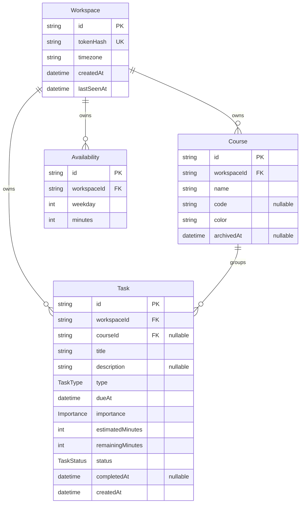

# Data model

The database is PostgreSQL. The source of truth is
`apps/api/prisma/schema.prisma`; the initial migration lives in
`apps/api/prisma/migrations/20261024101628_init/migration.sql`.

All timestamps are stored as `timestamp with time zone` (`TIMESTAMPTZ(3)`).
Values are written in UTC; calendar-day logic (for example weekly availability)
uses the workspace timezone. IDs are UUID strings generated by Prisma and stored
as `TEXT`.

## Diagram

## Models

### `Workspace`

Anonymous workspace identified by a cookie secret. Only the secret hash is
stored.

| Column       | Type             | Null | Default             | Notes                                           |
| ------------ | ---------------- | ---- | ------------------- | ----------------------------------------------- |
| `id`         | `TEXT`           | no   | Prisma `uuid()`     | Primary key                                     |
| `tokenHash`  | `TEXT`           | no   | —                   | Unique; SHA-256 hex digest of the cookie secret |
| `timezone`   | `TEXT`           | no   | `Europe/Madrid`     | IANA timezone; validated by Zod                 |
| `createdAt`  | `TIMESTAMPTZ(3)` | no   | `CURRENT_TIMESTAMP` | Creation instant                                |
| `lastSeenAt` | `TIMESTAMPTZ(3)` | no   | `CURRENT_TIMESTAMP` | Updated at most once per hour on activity       |

### `Course`

A subject or grouping owned by one workspace.

| Column        | Type             | Null | Default         | Notes                |
| ------------- | ---------------- | ---- | --------------- | -------------------- |
| `id`          | `TEXT`           | no   | Prisma `uuid()` | Primary key          |
| `workspaceId` | `TEXT`           | no   | —               | FK to `Workspace.id` |
| `name`        | `TEXT`           | no   | —               | Display name         |
| `code`        | `TEXT`           | yes  | —               | Optional short code  |
| `color`       | `TEXT`           | no   | —               | UI colour            |
| `archivedAt`  | `TIMESTAMPTZ(3)` | yes  | —               | Null means active    |

### `Task`

A piece of work with a deadline and a user-owned remaining effort.

| Column             | Type             | Null | Default             | Notes                                  |
| ------------------ | ---------------- | ---- | ------------------- | -------------------------------------- |
| `id`               | `TEXT`           | no   | Prisma `uuid()`     | Primary key                            |
| `workspaceId`      | `TEXT`           | no   | —                   | FK to `Workspace.id`                   |
| `courseId`         | `TEXT`           | yes  | —                   | FK to `Course.id`; null when ungrouped |
| `title`            | `TEXT`           | no   | —                   | Short description                      |
| `description`      | `TEXT`           | yes  | —                   | Optional long description              |
| `type`             | `TaskType`       | no   | —                   | Enum below                             |
| `dueAt`            | `TIMESTAMPTZ(3)` | no   | —                   | Deadline instant (UTC)                 |
| `importance`       | `Importance`     | no   | —                   | Enum below                             |
| `estimatedMinutes` | `INTEGER`        | no   | —                   | Estimated effort, minutes              |
| `remainingMinutes` | `INTEGER`        | no   | —                   | User-owned remaining effort, minutes   |
| `status`           | `TaskStatus`     | no   | —                   | Enum below                             |
| `completedAt`      | `TIMESTAMPTZ(3)` | yes  | —                   | Set when the task becomes `DONE`       |
| `createdAt`        | `TIMESTAMPTZ(3)` | no   | `CURRENT_TIMESTAMP` | Creation instant                       |

### `Availability`

Weekly capacity per ISO weekday. A workspace has at most one row per weekday.

| Column        | Type      | Null | Default         | Notes                              |
| ------------- | --------- | ---- | --------------- | ---------------------------------- |
| `id`          | `TEXT`    | no   | Prisma `uuid()` | Primary key                        |
| `workspaceId` | `TEXT`    | no   | —               | FK to `Workspace.id`               |
| `weekday`     | `INTEGER` | no   | —               | 1 = Monday … 7 = Sunday (ISO)      |
| `minutes`     | `INTEGER` | no   | —               | Available minutes for that weekday |

### Enums

| Enum         | Values                                            |
| ------------ | ------------------------------------------------- |
| `TaskType`   | `ASSIGNMENT`, `PROJECT`, `EXAM`, `STUDY`, `OTHER` |
| `Importance` | `LOW`, `MEDIUM`, `HIGH`                           |
| `TaskStatus` | `TODO`, `IN_PROGRESS`, `DONE`                     |

## Constraints, foreign keys and indexes

| Object                                 | Kind        | Definition / action                                            |
| -------------------------------------- | ----------- | -------------------------------------------------------------- |
| `Workspace_tokenHash_key`              | Unique      | `Workspace(tokenHash)`                                         |
| `Availability_workspaceId_weekday_key` | Unique      | `Availability(workspaceId, weekday)`                           |
| `Course_workspaceId_fkey`              | Foreign key | `Course.workspaceId → Workspace.id`, `ON DELETE CASCADE`       |
| `Task_workspaceId_fkey`                | Foreign key | `Task.workspaceId → Workspace.id`, `ON DELETE CASCADE`         |
| `Availability_workspaceId_fkey`        | Foreign key | `Availability.workspaceId → Workspace.id`, `ON DELETE CASCADE` |
| `Task_courseId_fkey`                   | Foreign key | `Task.courseId → Course.id`, `ON DELETE SET NULL`              |
| `task_estimated_minutes_nonneg`        | CHECK       | `"estimatedMinutes" >= 0`                                      |
| `task_remaining_minutes_nonneg`        | CHECK       | `"remainingMinutes" >= 0`                                      |
| `availability_weekday_range`           | CHECK       | `"weekday" BETWEEN 1 AND 7`                                    |
| `availability_minutes_range`           | CHECK       | `"minutes" BETWEEN 0 AND 1440`                                 |
| `Course_workspaceId_idx`               | Index       | `Course(workspaceId)`                                          |
| `Task_workspaceId_dueAt_idx`           | Index       | `Task(workspaceId, dueAt)`                                     |
| `Task_workspaceId_status_idx`          | Index       | `Task(workspaceId, status)`                                    |

PostgreSQL does not index foreign-key columns automatically. `Course.workspaceId`
is indexed for workspace-scoped reads and cascade deletes; the Task indexes also
cover `workspaceId` and support the due-date and status filters used by the
priority engine. The CHECK constraints cannot be expressed in Prisma, so they are
appended to the migration by hand and covered by integration tests that assert
their names.

## Design notes

- **`remainingMinutes` is user-owned.** It is not derived from study sessions;
  the person knows how much work is left. Sessions (phase 4) may propose a new
  value, but the user confirms or corrects it. Therefore the database does not
  enforce `remainingMinutes <= estimatedMinutes`.
- **Default availability is application data, not a database default.** The
  database only stores and validates rows. The API seeds Monday–Friday 180
  minutes and Saturday–Sunday 120 minutes (adjustable) when a workspace is
  created, in P2-T5.
- **Timezone validity is enforced in application code.** The database stores the
  IANA name with a `Europe/Madrid` default; Zod validation arrives in P2
  validation schemas, before any row is written. Calendar-day arithmetic in
  `packages/core` receives the timezone and enforces the engine rules.
- **No session tables yet.** `StudySession` and `SessionSource` are deliberately
  absent; they arrive in P4-T1. Adding them later is an additive migration.
- **Deleting a workspace is a full cleanup.** Courses, tasks and availability
  cascade with the workspace. Deleting a course keeps its tasks and clears their
  `courseId`, so no task is lost by accident.

## Known limitation

`Task.courseId` only references `Course.id`. The database cannot prove that the
course belongs to the same workspace as the task. A task in workspace A could,
at database level, point to a course in workspace B.

The API service layer must load the course with the task's `workspaceId` before
linking or updating `courseId`, and reject any mismatch. P2-T4 adds an
integration test for this rule. A database-level fix would require a composite
foreign key such as `(courseId, workspaceId) → (id, workspaceId)` plus a unique
constraint on `Course(id, workspaceId)`; it is deferred to keep the Prisma
relations and `ON DELETE SET NULL` behaviour simple. See ADR-0007.
